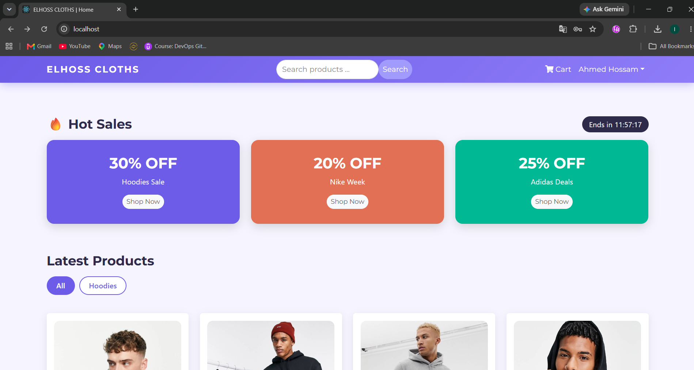

# ELHOSS CLOTHS

Online clothing store built with the **MERN stack**, containerized with **Docker**, deployed on **Kubernetes**, and automated with a **Jenkins** CI/CD pipeline.



> Based on the open-source clothshop project by Said Mounaim, extended with a new UI, new features, and a full DevOps setup.

## Features

- Product reviews and ratings
- Product pagination and search
- Category tabs (Hoodies / T-Shirts / Shoes)
- Hot Sales section with live countdown
- Services section with detail popups
- Redesigned purple theme
- User profile, cart, checkout, PayPal
- Admin product, user and order management
- Database seeder

## Tech Stack

| Layer | Technology |
|---|---|
| Frontend | React, Redux, React Bootstrap |
| Backend | Node.js, Express, JWT |
| Database | MongoDB |
| Containers | Docker, Docker Compose |
| Orchestration | Kubernetes (minikube) |
| CI/CD | Jenkins |

## Run with Docker Compose

Create a `.env` file in the root:

```
JWT_SECRET=change_me_to_something_long
NODE_ENV=development
PAYPAL_CLIENT_ID=sb
```

Then:

```bash
docker compose up --build -d
docker compose exec backend-cloth node seeder.js
```

Store: http://localhost

## Run on Kubernetes (minikube)

```bash
minikube start --driver=docker
kubectl config current-context

docker compose build
minikube image load cloth-shop-frontend:latest
minikube image load cloth-shop-backend-cloth:latest

kubectl apply -f k8s/cloth.yaml
kubectl exec -n cloth-app deploy/cloth-backend -- node seeder.js
kubectl port-forward -n cloth-app svc/frontend-cloth 8080:80
```

Open http://localhost:8080

## CI/CD with Jenkins

The pipeline: **Checkout** → **Build images** → **Push** → **Deploy** (`kubectl apply -f k8s/cloth.yaml` and wait for rollout).

See the `Jenkinsfile` in the repo root.

## Credits

- Original project: Said Mounaim
- Extended and deployed by: Ahmed Hossam

License: MIT